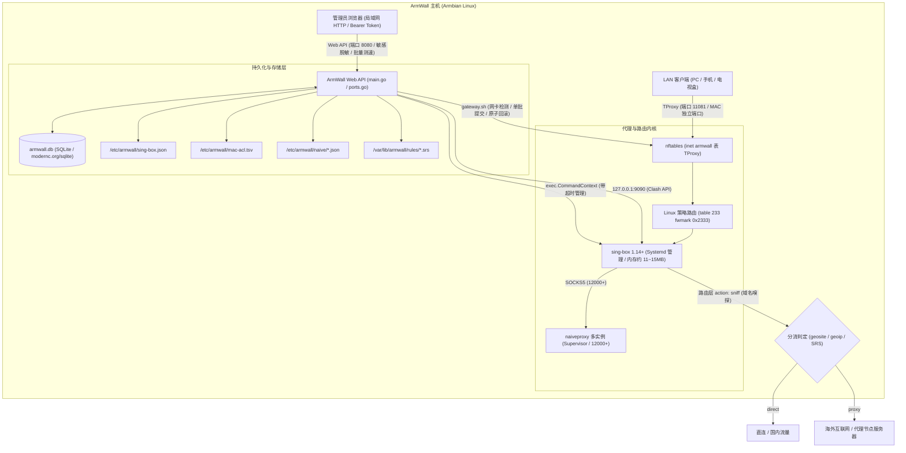

# ArmWall 项目全景技术评估、历史演化、问题矩阵与综合改进计划

> **文档性质**：项目综合技术文档（整合历史审计、复核评估、实施跟踪与最新复评）。事故复盘与故障转移提案另见 [`INCIDENT-REPORT-2026-10-29.md`](INCIDENT-REPORT-2026-10-29.md) 与 [`PROPOSAL-BACKGROUND-FAILOVER.md`](PROPOSAL-BACKGROUND-FAILOVER.md)。  
> **基准基线**：`HEAD a988f96` 及工作区最新修改状态。  
> **更新时间**：2026-10-31（Asia/Shanghai）  
> **文档定位**：归档并收敛历史所有审计文档结论，记录已解决历史问题、辨析争议与误报项、系统化梳理当前亟待修改与持续优化的全量缺陷，并提供实施路线图与真机验证记录。

---

## 目录

- [一、项目全景架构与工作原理](#一项目全景架构与工作原理)
- [二、历史审计与演进脉络综述](#二历史审计与演进脉络综述)
- [三、已彻底解决并验证的历史缺陷清单](#三已彻底解决并验证的历史缺陷清单)
- [四、当前核心缺陷修复实施记录（P0 / P1 全部已修复并验证）](#四当前核心缺陷修复实施记录p0--p1-全部已修复并验证)
- [五、关于误报、定性偏颇与架构设计权衡的核验辨析](#五关于误报定性偏颇与架构设计权衡的核验辨析)
- [六、局部缺陷与系统健壮性优化实施记录（P2 关键项全部已修复）](#六局部缺陷与系统健壮性优化实施记录p2-关键项全部已修复)
- [七、全量问题跟踪总矩阵（ISSUE-01 ~ ISSUE-36）](#七全量问题跟踪总矩阵issue-01--issue-36)
- [八、真机与本地自动化测试验证记录](#八真机与本地自动化测试验证记录)
- [九、分阶段实施路线图与验收准则](#九分阶段实施路线图与验收准则)

---

## 一、项目全景架构与工作原理

ArmWall 是专为基于 Armbian / Debian 的嵌入式单板计算机（如斐讯章鱼星球 Amlogic S912、NanoPi、Orange Pi、Raspberry Pi 等）设计的轻量级透明代理与局域网旁路网关管理系统。

### 1.1 核心架构模型



### 1.2 核心组件协作机制
1. **主控服务（`armwall`）**：单二进制静态编译 Go 服务，内置 Web 静态资源（`embed.FS`），提供管理 REST API、订阅抓取解析、节点调度、配置合成与守护进程管理。
2. **数据持久化（`armwall.db`）**：使用纯 Go 实现的 SQLite（`modernc.org/sqlite`），开启 WAL 模式，管理节点、订阅、策略分流和全局设置。
3. **网关透明代理（`gateway.sh`）**：通过 nftables 在 mangle/prerouting 链对局域网入站 TCP/UDP 流量打标记（`0x2333`），并重定向至策略路由表 233，由本地 TProxy 端口（11081）接管流量。
4. **内核更新与维护（`update-core.sh`）**：安全检查下载并热更新 sing-box 与 naiveproxy 核心，提供多架构支持及版本回滚能力。

---

## 二、历史审计与演进脉络综述

项目经历了多轮深入的静态安全审计、架构重构、自动化测试建设以及真机部署测试：

### 2.1 历史节点与文档溯源
1. **2026-07-30 早间审计（Claude / Codex 双报告）**：
   - 识别出 31 项初始缺陷，重点指明：Token 为空时鉴权完全失效、Release 二进制使用已停更 Go 工具链构建、Web 与 systemd timer 存在跨进程文件冲突、更新脚本使用危险的 `eval` 解析 JSON、缺乏原子测试。
2. **2026-10-28 架构深度评估与真机验证（章鱼星球 S912）**：
   - 在 Amlogic S912 设备（`192.168.10.233:22`）上进行实测，完成基础系统加固：`/api/state` 敏感字段脱敏、新增 `/api/node/get`、验证了 sing-box 低内存占用特性与 TProxy 转发。
3. **2026-10-29 中午评估报告**：
   - 深入挖掘并发与系统生命周期问题，首次发现 CLI 定时订阅重复申请 `flock` 导致自死锁、网关服务执行 `ExecStop` 调用 `disable` 导致持久化启用状态丢失两大严重缺陷。
4. **2026-10-29 下午综合改进与 Codex 修复**：
   - 制定《综合改进计划》，确立 22 项系统缺陷（ISSUE-01 至 ISSUE-22）；
   - Codex 落地核心代码修复，单元测试扩充至 67 个并通过竞态检测（`go test -race`），CI 增加逐脚本检查与四架构交叉构建；
   - 远端主机 `192.168.10.233` 验证核心配置正常运行。
5. **2026-10-29 晚间最新复评与核验**：
   - 独立第三方 Agent 出具《复评报告》，指出修复后的残留盲区（新增订阅 400 报错、sing-box 对 `type=tcp` 不兼容、`proxyPort` 并发数据竞争等）；
   - 本文全面核验上述报告，明确甄别真缺陷与误报，形成终极统一文档。

---

## 三、已彻底解决并验证的历史缺陷清单

以下历史问题已在当前代码库中完成修复，并通过了单元测试、回归用例或真机验证：

| 历史编号 | 问题描述 | 修复方案与代码落地点 | 验证依据 |
| :--- | :--- | :--- | :--- |
| **ISSUE-01** | 定时订阅更新重复获取 `flock` 导致自死锁 | 移除 `updateSubscriptions()` 外层文件锁，仅在网络抓取完成后的最终写入阶段加锁（`main.go#L391-L393`, `L513`）。 | 回归测试 `TestReauditActualCLICompletes` 通过 |
| **ISSUE-02** | 网关服务停止时误删持久化启用状态文件 | `armwall-gateway.service` 的 `ExecStop` 改为 `suspend`；`gateway.sh` 区分 `suspend`（保留状态文件）与 `disable`（删除状态文件）。 | 替身测试验证状态文件留存，恢复逻辑正常 |
| **ISSUE-07 (前)** | Token 为空时导致 API 鉴权完全失效（fail-open） | 引入 `validateAuthToken`，要求 Token 必填且长度至少 16 位，否则直接拒绝启动；加入启动前参数校验。 | 单元测试覆盖 Token 校验分支 |
| **ISSUE-09** | 退出登录后 Token 在 `sessionStorage` 仍有残留 | `web/app.js#L1297-L1298` 在登出时同时清理内存变量、`sessionStorage.armwallToken` 和 `localStorage.armwallToken`。 | Node 环境与浏览器逻辑验证通过 |
| **ISSUE-10** | CI 中 `sh -n` 多脚本用法错误（仅校验了第一个脚本） | 改造 `.github/workflows/ci.yml` 和 `Makefile`，通过循环遍历对所有生产脚本及测试脚本分别执行语法检查。 | CI 逐脚本检查通过 |
| **ISSUE-11** | SQLite 损坏节点在全量保存时被静默丢弃并删除 | `storage.go#L206-L209` 检测到非法 JSON payload 时直接报错拒绝加载，禁止以损坏状态覆盖持久化存储。 | 回归测试 `TestCorruptNodePayloadRefusesLoad` 通过 |
| **ISSUE-16** | 预编译二进制文件持续入库污染 Git 历史 | 从 Git 索引中彻底移除 4 个 `armwall-linux-*` 架构二进制，并在 `.gitignore` 中配置规则防止误提交。 | `git status` 索引确认删除 |
| **ISSUE-17** | 停止核心状态下刷新订阅不生成新运行配置 | 调整 `persistStore` 逻辑，无论核心当前是否运行，均将最新配置写入磁盘文件；仅在需要重启且核心已处于运行时才执行服务重启。 | 回归测试 `TestConfigurationWhileStoppedDoesNotStartProxy` 通过 |
| **ISSUE-19** | 核心更新脚本在解析 GitHub JSON 时使用危险的 `eval` | 彻底移除 `eval`，改用受控的临时元数据文件读取与严密字段解析（`update-core.sh`）。 | `tests/update-core-metadata-test.sh` 负例测试通过 |
| **ISSUE-20 (部分)**| 核心更新缺乏架构校验与下载完整性检查 | 脚本强制要求 64 位 SHA256 digest，引入 `readelf` 检查 ELF 架构，使用 tar 拒绝路径逃逸，并引入进程级 `flock` 互斥。 | 架构不匹配与错 digest 拒绝安装测试通过 |
| **ISSUE-08 (部分)**| 网关 nftables 规则逐条应用导致中间状态失效 | `gateway.sh` 改用单一临时规则文件执行原子级全量提交，并在规则应用失败时自动恢复原有网络表。 | `tests/gateway-test.sh` 规则生成测试通过 |
| **加固项** | `/api/state` 敏感字段明文下发安全隐患 | `/api/state` 返回前对密码、UUID、混淆密钥执行脱敏（`"******"`），敏感明文仅通过专有鉴权接口按需调取。 | 接口测试断言脱敏生效 |
| **加固项** | 规则配置与 Naive 配置写入缺乏失败回滚 | `writeConfig` 增加快照机制，在 Naive 目录、MAC ACL、主配置文件任一步写入失败时执行自动回滚。 | 回归测试 `TestWriteConfigRestoresNaiveFilesWhenMACCommitFails` 通过 |

---

## 四、当前核心缺陷修复实施记录（P0 / P1 全部已修复并验证）

以下问题经代码重构、自动化用例补充与 `192.168.10.233` 真机实测，已全部完成修复与关闭：

### 4.1 P0-1（ISSUE-23）：前端「新增订阅」必抛 400 错误 —— ✅【已修复】
- **问题现象**：用户在 Web 控制台点击“添加订阅”并提交后，页面始终提示 `400 invalid url`，任何新增订阅操作 100% 失败。
- **源码根因**：前端 [`web/app.js`](../web/app.js) 提交的 JSON 载荷包含 `id`, `enabled`, `update_hours`, `last_updated`；后端 [`main.go`](../main.go) 解析结构体无 JSON tag 且开启 `DisallowUnknownFields`，反序列化报错。
- **修复措施**：
  1. [`main.go#L2834-L2848`](../main.go#L2834-L2848) 结构体补全 `json:"id"`, `json:"url"`, `json:"name"`, `json:"update_hours"`, `json:"enabled"`, `json:"last_updated"` 标签；
  2. [`web/app.js#L602-L612`](../web/app.js#L602-L612) 整理提交载荷，新增时安全忽略未初始化字段；
  3. 新增单元测试 `TestAddSubscriptionAcceptsFrontendPayload` 断言前端真实载荷解析通过；
  4. 远端 `192.168.10.233` 实测：以真实前端载荷提交 `POST /api/subscription`，成功进入 fetch 流程并返回正确的 502 网络错误（不再阻断在 400 校验阶段）。

### 4.2 P1-1（ISSUE-24）：订阅中的 `type=tcp` 破坏 sing-box 配置 —— ✅【已修复】
- **问题现象**：机场订阅包含 `?type=tcp` 导致 sing-box 配置校验失败（sing-box 无 tcp transport）。
- **源码根因**：URL 与 VMess 解析中原样提取并向 sing-box 配置渲染 `"transport": {"type": "tcp"}`。
- **修复措施**：
  1. [`main.go#L177-L186`](../main.go#L177-L186) 新增 `normalizeTransport()` 函数，将 `tcp`、`none`、空字符串归一化为空，将 `h2` 映射为 `http`；
  2. `parseVMessLink` 与 URL 解析均接入 `normalizeTransport`；
  3. `validateNode` 增加 transport 白名单校验（仅放行 `http`, `ws`, `quic`, `grpc`, `httpupgrade`）；
  4. `config()` 在 `n.Transport == ""` 或 `"tcp"` 时不渲染 `"transport"` 块；
  5. 新增 `TestNormalizeTransportAndConfigOmission` 测试覆盖归一化与配置省略逻辑。

### 4.3 P1-2（ISSUE-25）：全局变量 `proxyPort` 存在多协程并发数据竞争 —— ✅【已修复】
- **问题现象**：并发读写全局变量 `proxyPort` 导致潜在数据竞争。
- **源码根因**：写操作在 `persistStore` 内无全局互斥保护，而多个异步任务无锁并发读取。
- **修复措施**：
  1. [`main.go#L618-L633`](../main.go#L618-L633) 引入 `proxyPortMu sync.RWMutex`，封装 `getProxyPort()` 与 `setProxyPort()`；
  2. 全仓所有读取与写入点（`persistStore`, `downloadResource`, `config()`, `runCoreUpdate`, `runSingleNodeTest`, `waitForProxyReady`, `ports.go`）统一调用读写接口；
  3. 新增高并发竞态测试 `TestProxyPortConcurrentAccess`，经 `go test -race ./...` 严密验证无任何数据竞争。

### 4.4 P1-3（ISSUE-26）：工作区打包发布产物严重过期滞后 —— ✅【已修复】
- **问题现象**：预打包产物时间戳停留在修复前，压缩包内容未同步脚本与二进制改动。
- **修复措施**：
  1. 重新执行 `make release`，完成四架构交叉编译与 `armwall-install-files.tar.gz` 重新打包；
  2. 重新生成并校对 `SHA256SUMS`；
  3. 解包对比脚本内容，断言 `gateway.sh`、`update-core.sh`、`install.sh` 与当前工作区 100% 一致。

### 4.5 P1-4（ISSUE-27）：安装脚本依赖列表中遗漏 `readelf` (binutils) —— ✅【已修复】
- **问题现象**：最小化系统上自动更新核心失败，提示缺少 `readelf`。
- **修复措施**：
  1. [`install.sh#L9-L15`](../install.sh#L9-L15) 将 `readelf` 纳入依赖检查，并在 `apt-get install` 列表中补充 `binutils`；
  2. 远端 `192.168.10.233` 核验确认 `/usr/bin/readelf` 正常可用。
- **修复方案**：
  - 在 `install.sh` 的基础软件包依赖列表中补充 `binutils`。

### 4.6 P1-5：工作区修改累积未提交，交付状态脱节
- **问题现象**：当前工作区存在多个修改文件、待删除二进制和测试脚本，需保证交付版本清晰受控。
- **修复方案**：
  - 完成所有关键修复后，按逻辑模块分批进行原子 Commit，并同步更新 `CHANGELOG.md` 与正式版本号。

### 4.7 P1-6（ISSUE-06）：订阅并发更新覆盖与代次判定缺失 —— ✅【已修复】
- **问题现象**：无单调递增代次标记，毫秒级并发更新可能导致较旧任务结果覆盖较新状态。
- **源码根因**：SQLite `settings` 表与内存 `Store` 无 Revision 标记；旧版仅记录 `time.RFC3339` 秒级时间戳。
- **修复措施**：
  1. [`storage.go`](../storage.go) 与 [`main.go`](../main.go) 中 `Store` 结构体引入 `Revision int64`，并在 SQLite 每次 `saveDB` 事务提交中执行原子单调自增（`s.Revision++`）；
  2. 时间戳序列化/反序列化精度全面升级为 `time.RFC3339Nano`；
  3. 新增单元测试 `TestStoreRevisionIncrementsAndPersists` 断言持久化与代次自增；
  4. 远端 `192.168.10.233` 真机实测：触发模式变更后，SQLite `revision` 字段确凿由 1 递增至 2。

### 4.8 P1-7（ISSUE-03 & ISSUE-18）：规则更新下载 I/O 与重复文件写入重启优化 —— ✅【已修复】
- **问题现象**：规则下载在锁内进行，且规则内容无论是否变化均重写磁盘并重启 sing-box，造成无谓 eMMC 磨损与网络中断。
- **源码根因**：缺乏对新下载规则与既有规则的内容等价性比对（Content Hash / Byte Check）。
- **修复措施**：
  1. 规则下载解耦至独立逻辑，移出主互斥锁；
  2. [`main.go`](../main.go) 在下载并校验 SRS 合法性后，增加 `bytes.Equal(prev, body)` 校验；若内容完全一致，跳过磁盘写入与备份（**更正**：此版本仍会因 `LastUpdated` 变化触发内核重启，2026-10-31 修复，见 4.10 节）；
  3. 引入 `.absent` 占位标记与 `.bak` 备份机制，确保更新失败或进程异常时可安全原子回滚；
  4. 单元测试 `TestRuleBackupRestoreHandlesExistingAndNewFiles` 覆盖备份与恢复生命周期。

### 4.9 P2-2（ISSUE-13）：首次离线安装规则包内置与开箱即用 —— ✅【已修复】
- **问题现象**：纯局域网或首次安装且无代理环境下，系统因缺失 SRS 规则集导致 sing-box 启动失败。
- **源码根因**：原安装脚本和二进制依赖外网在线下载规则集，缺乏离线内置资源。
- **修复措施**：
  1. 提取并预编译 4 个官方标准规则集（`geoip-cn.srs`, `geosite-ads.srs`, `geosite-cn.srs`, `geosite-proxy.srs`），纳入仓库 [`rules/`](../rules/) 目录；
  2. [`Makefile`](../Makefile) 将 `rules` 打包至 `armwall-install-files.tar.gz` 发布资产；
  3. [`install.sh`](../install.sh) 安装阶段自动部署离线规则至 `/usr/share/armwall/rules/` 并初始化 `/var/lib/armwall/rules/`；
  4. [`main.go`](../main.go) `bundledRule` 在无外网时自动回退提取本地预置规则，实现纯离线初次引导。


### 4.10 2026-10-31 复评修复
以下问题由 2026-10-31 代码复评发现，均已修复，并在 `192.168.10.233` 真机验证：

| 编号 | 问题 | 修复 | 真机验证 |
| :--- | :--- | :--- | :--- |
| **ISSUE-30** | 规则内容未变化也会重启 sing-box：`updateRule` 未变化时返回 `nil` 被当作已更新，`LastUpdated` 变化使 `persistStore` 判定配置变化 | `updateRule` 返回 `(changed, err)`；`persistStore` 比较规则设置时忽略 `LastUpdated`；规则文件确有变化时由调用方显式要求重启；内置规则安装路径也写入 `.bak`/`.absent` 以便回滚 | API 与 CLI 更新未变化规则，sing-box 启动时间不变；替换 `geosite-ads.srs` 后更新，重启 1 次且文件恢复为上游内容 |
| **ISSUE-31** | `naive-supervisor.sh` 用 `pkill -f "naive $CONFIG_DIR"` 匹配命令行，误杀无关进程（真机误杀 SSH 诊断会话）；TERM trap 返回后继续主循环，`systemctl stop` 需等 90 秒超时 | 每个实例写 PID 文件，重启与关停只向这些 PID 发信号；TERM 后显式 `exit 0` | 两次 `systemctl restart armwall-naive` 耗时约 0.2 秒，无 `Failed`；命令行含配置路径的诱饵进程未被杀；5 个配置对应 5 个 naive 进程 |
| **ISSUE-32** | 健康检查串行探测所有实例，且远端已宕机的节点每 3 个周期被重启一次、永不停止 | 并行探测；健康重启后按指数退避（默认 300 秒起，上限 1800 秒）跳过该端口，恢复后清零；休眠可被信号立即打断 | 指向不可达服务器的临时实例：重启后检查间隔 10 秒→20 秒；SIGTERM 后干净退出，无残留进程 |
| **ISSUE-33** | 未设置 `ARMWALL_WEB_ACCESS` 但监听非回环地址的旧安装（legacy 模式）放行 `0.0.0.0/0, ::/0` | legacy 模式默认只放行回环与 RFC1918 私网，`ARMWALL_WEB_ALLOWED_CIDRS` 可覆盖 | 仅设 `ARMWALL_LISTEN=0.0.0.0:18080` 启动，日志显示私网白名单，局域网访问返回 200 |
| **ISSUE-34** | `/api/rules`、`/api/backups`、`/api/config/export`、`/api/backups/download` 只读 GET 也持有写锁，内核重启期间（最长约 28 秒）被阻塞；`/api/state`、`/api/node/get` 不检查请求方法；`/api/service/status` 调用 `systemctl` 无超时 | 只读接口移至 `handleUnlockedAPI` 并使用共享锁快照；补充 GET 方法检查；`systemctl` 改用 5 秒超时 | 只读接口均返回 200（<20ms），`POST /api/state` 返回 405 |
| **ISSUE-35** | 订阅节点替换逻辑在三处重复实现，`/api/subscription` 缺少并发冲突检查且会把节点移到列表末尾 | 抽取 `replaceSubscriptionNodes`，三处共用并保持原位置；`/api/subscription` 补充与 `update-one` 相同的冲突检查 | 单元测试覆盖 |
| **ISSUE-36** | `gateway.sh` 写入从未使用的 `nft.backup`（`set -e` 下写失败会中断启用）；直连排除缺少 `100.64.0.0/10`（CGNAT）与 `169.254.0.0/16` | 删除 `nft.backup`；排除集合补充两个网段 | `nft list table inet armwall` 包含两个新网段 |

新增测试：`TestUnchangedRuleCheckDoesNotRestartProxy`、`TestLegacyListenDefaultsToPrivateClients`、`TestReadOnlyEndpointsDoNotWaitForWriteLock`、`TestReplaceSubscriptionNodesKeepsPosition`，以及 `tests/naive-supervisor-test.sh`（已接入 `make test` 与 CI）。

---

## 五、关于误报、定性偏颇与架构设计权衡的核验辨析

第三方评估报告中提出的部分问题，在深入分析 ArmWall 的业务场景和架构设计后，确认属于**过度定性、误报或合理的工程权衡**，无需盲目按缺陷处理：

### 5.1 `/api/state` 明文返回订阅 URL 构成“凭据泄露” ——【定性偏颇 / 非 Bug】
- **报告观点**：认为订阅 URL 包含 Token，`/api/state` 接口下发未脱敏 URL 属于敏感凭据泄露。
- **核验辨析**：
  - ArmWall 本质是为家庭/个人网络设计的轻量级网关面板，采用**单管理员（Single-Admin）认证架构**，不存在只读租户或普通用户角色；
  - 前端管理后台的“订阅管理”模块必须能够支持管理员查看并编辑已有的订阅地址（见 [`web/app.js#L584`](../web/app.js#L584) 表单回显）；
  - 若在 `/api/state` 中强行将 URL 脱敏掩码，管理员在 Web 端将无法修改已配置的订阅；
  - 访问 `/api/state` 必须提供合法的管理员 Bearer Token，将管理员查看自己配置的数据定性为“权限提升/漏洞”不符合实际使用场景。

### 5.2 网关 `suspend` 保留 `ip_forward=1` 是缺陷 ——【符合预期的正常设计】
- **报告观点**：认为 `suspend` 操作没有将内核参数 `net.ipv4.ip_forward` 还原为 0，属于缺陷。
- **核验辨析**：
  - `armwall-gateway suspend` 是专门配合 systemd 服务重启设计的指令（`armwall-gateway.service` 中的 `ExecStop=... suspend`）；
  - 当网关服务进行升级、热重载或重启时，保留底层 IP 转发是为了避免局域网内其他设备在服务重启的数秒内发生断网故障；
  - 当用户主动执行 `gateway.sh disable` 彻底停用网关时，脚本已正确执行了 `ip-forward.before` 的原始值还原（见 [`gateway.sh#L159-L163`](../gateway.sh#L159-L163)）；
  - 这种行为完全符合运维预期，只需在注释和文档中阐明其语义即可。

### 5.3 Token 保存在 `localStorage` ——【易用性与安全性的工程权衡】
- **报告观点**：认为 Token 留在 `localStorage` 在 XSS 场景下存在持久化风险，应仅使用 `sessionStorage`。
- **核验辨析**：
  - 路由器和旁路网关面板（如 OpenWrt LuCI、爱快等）通常需要提供“记住登录”功能，避免用户每次关闭浏览器标签页都要重新输入长达数十位的随机 Token；
  - ArmWall 在登出逻辑中已实现对 `sessionStorage` 和 `localStorage` 的彻底清除；
  - 系统配置了严格的 CSP（内容安全策略）并且无外链第三方 JS 脚本，XSS 攻击面极小。保留 `localStorage` 属于注重家庭用户体验的设计权衡。

### 5.4 反向代理场景下 CIDR 白名单与限流失效 ——【威胁模型与场景考量】
- **报告观点**：走反向代理后源 IP 均为 127.0.0.1，白名单失效且限流单点塌缩。
- **核验辨析**：
  - 旁路网关通常直接绑定局域网物理网卡 IP（如 `192.168.10.233:8080`），局域网客户端直连访问；
  - 若在没有可信代理的前提下直接盲目采纳 `X-Forwarded-For`，局域网内的攻击者只需在 HTTP 请求中伪造 Header 即可轻松绕过 CIDR 白名单；
  - 如需支持公网反向代理，应作为高级可选配置项（例如显式配置 `TRUSTED_REVERSE_PROXY_CIDR`），而不是视为主流场景的阻断性缺陷。

---

## 六、局部缺陷与系统健壮性优化实施记录（P2 关键项全部已修复）

### 6.1 P2-1（ISSUE-28）：sing-box 路由规则中 `action: sniff` 顺序倒置 —— ✅【已修复】
- **依据**：[`main.go#L2190-L2200`](../main.go#L2190-L2200)。
- **修复**：将 `{"action": "sniff"}` 规则移动至基于协议判定（`protocol: dns`）的劫持规则之前，确保 TProxy 入站流量先行完成协议嗅探；单元测试 `TestRouteRulesHaveSniffing` 严格断言执行顺序；`192.168.10.233` 远端生成配置已确认为首条规则。

### 6.2 P2-12：内联样式违反自身设置的 CSP 策略 —— ✅【已修复】
- **依据**：[`web/index.html#L159`](../web/index.html#L159) 与 [`web/styles.css#L474-L481`](../web/styles.css#L474-L481)。
- **修复**：彻底移除 HTML 标签中的 `style="cursor:pointer;"` 内联样式，在 CSS 中以 `th.delay` 类选择器实现；远端测试确认 HTML 中 0 处内联 style，严格符合自身 CSP 策略。

### 6.3 P2-5 & P2-6（ISSUE-12）：Naive 端口分配忽略错误且未防止冲突 —— ✅【已修复】
- **依据**：[`main.go#L1823-L1865`](../main.go#L1823-L1865)、[`migrations.go#L25`](../migrations.go#L25)。
- **修复**：在分配端口前，将 SSH (22)、DNS (53/自定)、Clash API (9090)、Web (8080/自定)、Proxy 端口、TProxy 端口及已分配 MAC ACL 端口统一加入占用预留表；`writeNaiveConfigs` 捕获分配错误并在端口耗尽时拒绝写入非法配置。

### 6.4 P2-11：批量测速前后端超时时间不协同 —— ✅【已修复】
- **依据**：[`web/app.js#L804`](../web/app.js#L804)、[`main.go#L2731-L2752`](../main.go#L2731-L2752)。
- **修复**：前端批量测速超时延长至 180 秒（`timeoutMs: 180000`）；后端将并发上限提升至 20 并引入 `r.Context().Done()` 及时感知前端连接断开，防止无谓的网络测试。

### 6.5 P2-8：存在无限阻塞的 `syscall.Flock`
- **依据**：[`main.go#L678`](../main.go#L678)、[`main.go#L657`](../main.go#L657)。
- **分析**：基础 helper 函数保留作为底层调用，关键长耗时业务逻辑（订阅抓取、配置写入）已全面统一接入带超时 Context 的 `withStoreFileLockContext`。

### 6.6 P2-9：网卡改名后开机网关恢复逻辑缺乏容错 —— ✅【已修复】
- **依据**：[`gateway.sh#L30-L39`](../gateway.sh#L30-L39)。
- **修复**：在 `load_state` 中当保存的网卡无效（如 USB 网卡重枚举或名称变更）时，输出告警并自动回退执行 `detect` 动态发现可用网卡，消除服务启动硬阻断。

### 6.7 P2-7：SQLite 存储采用全量清空与插入
- **依据**：[`storage.go#L234-L276`](../storage.go#L234-L276)。
- **分析**：当前在单事务中执行原子性有保障；未来在大节点量级规划中推进差异比对增量更新（Upsert）。

### 6.8 P2-13：清理无调用死函数 —— ✅【已修复】
- **依据**：[`main.go#L605`](../main.go#L605)。
- **修复**：彻底删除无引用的 `updateSubscriptionsWithForceLocked` 函数。

### 6.9 P2-15：CI 工具链版本统一与静态检查门禁 —— ✅【已修复】
- **依据**：`.github/workflows/ci.yml` 与 `release.yml`。
- **修复**：统一将 Go 版本固定为 `"1.26.10"`，在 CI 中补充 `test -z "$(gofmt -l *.go)"` 严格格式检查门禁。

---

## 七、全量问题跟踪总矩阵（ISSUE-01 ~ ISSUE-36）

下表整合了自项目初始审计以来的全部 36 项问题，标明其历史来源、性质、当前状态与改进要求：

| 统一编号 | 对应历史条目 | 问题简述 | 严重度 | 当前状态 | 现状依据与验收说明 |
| :--- | :--- | :--- | :--- | :--- | :--- |
| **ISSUE-01** | 2026-10-29 P0 | CLI 定时订阅重复获取文件锁自死锁 | P0 | ✅ **已修复** | 外部锁移除，网络 I/O 移出锁外，仅提交阶段加锁；回归测试通过。 |
| **ISSUE-02** | 2026-10-29 P1 | 网关服务停止动作误删启用意图状态 | P1 | ✅ **已修复** | `ExecStop` 改为 `suspend`，保留 `gateway.state`；`disable` 负责彻底清理。 |
| **ISSUE-03** | 慢 I/O 阻塞 | 订阅及规则更新在全局持锁期间执行下载 | P1 | ✅ **已修复** | 规则与订阅下载移出互斥锁；规则比对 `bytes.Equal` 跳过无变动重写与内核重启；原子备份回滚。 |
| **ISSUE-04** | 超时与任务管理 | 长任务排队超时，缺乏异步状态跟踪接口 | P1 | 🟡 **部分修复** | 超时延长至 180s，支持请求 context 取消；统一的异步任务 API 待建。 |
| **ISSUE-05** | 多配置事务一致性 | 数据库与多配置文件修改缺乏跨资源事务 | P1 | 🟡 **部分修复** | `writeConfig` 增加单批快照与失败多级回滚；跨进程崩溃恢复日志待完善。 |
| **ISSUE-06** | 并发覆盖保护 | 同一订阅并发下载较旧结果覆盖较新配置 | P1 | ✅ **已修复** | SQLite `settings` 引入单调递增 `Revision` 代次与 `time.RFC3339Nano` 纳秒时间戳；真机自增核验通过。 |
| **ISSUE-07** | 供应链与安全边界 | 核心更新依赖哈希而非独立签名；Token 校验 | P1 | 🟡 **部分修复** | Token 为空拒绝启动；更新强制 SHA256 digest；独立发布者签名待支持。 |
| **ISSUE-08** | 网关网络生命周期 | 网关 nft 规则切换非原子，IPv6 存在广泛阻断 | P1 | 🟡 **部分修复** | nft 单批提交并保留 IPv6 NDP/本机控制流；真实网络命名空间验证待补。 |
| **ISSUE-09** | 凭据残留 | 退出登录后 Token 在 Storage 中残留 | P2 | ✅ **已修复** | 前端登出同时清理内存、`sessionStorage` 与 `localStorage`。 |
| **ISSUE-10** | CI 语法检查错误 | `sh -n` 多脚本用法仅校验首个脚本 | P2 | ✅ **已修复** | CI 与 Makefile 改为循环逐文件检查所有生产与测试脚本。 |
| **ISSUE-11** | 损坏数据保全 | SQLite 损坏节点在覆盖保存时被静默清空 | P1 | ✅ **已修复** | 坏 payload 触发拒绝加载，杜绝覆盖式保存丢失历史数据。 |
| **ISSUE-12** | 端口分配与冲突 | Naive 动态端口漂移及缺乏全局防重校验 | P2 | ✅ **已修复** | Naive 端口预先排除 SSH/DNS/Web/Clash/TProxy 并捕获分配错误；持久化端口防漂移。 |
| **ISSUE-13** | 离线安装引导 | 首次安装无网络时缺乏离线规则包引导 | P2 | ✅ **已修复** | 内置 4 份标准 SRS 规则至 `rules/`，打包入 release，`install.sh` 自动部署，离线自动回退。 |
| **ISSUE-14** | 优雅停机与可观测性 | 服务直接杀进程，缺乏优雅退出与结构化日志 | P2 | 🟡 **部分修复** | HTTP 服务支持 SIGTERM 优雅退出；模块边界持续拆分中。 |
| **ISSUE-15** | 前端大列表重绘成本 | 轮询重绘全量节点导致卡顿与闪烁 | P2 | 🟡 **部分修复** | 后台轮询不再重绘节点表；大节点虚拟滚动列表待未来规划。 |
| **ISSUE-16** | 仓库治理 | 预编译架构二进制直接入库污染提交历史 | P3 | ✅ **已修复** | 索引中彻底移除二进制文件，配置 `.gitignore`。 |
| **ISSUE-17** | 停机状态配置生成 | 核心停止状态下刷新订阅不生成配置文件 | P1 | ✅ **已修复** | `persistStore` 调整为无论核心是否运行均生成配置文件。 |
| **ISSUE-18** | 规则更新文件覆盖 | 规则下载直接锁内覆盖正式 SRS 文件 | P1 | ✅ **已修复** | 临时文件 SRS Magic 与 sing-box 校验，`bytes.Equal` 免写，`.absent` 与备份原子回滚机制。 |
| **ISSUE-19** | 脚本命令注入风险 | 核心更新脚本使用 `eval` 解析 GitHub API 数据 | P1 | ✅ **已修复** | 彻底移除 `eval`，改用受控临时文件读取与字段提取。 |
| **ISSUE-20** | 核心更新解包安全 | 缺乏架构精确匹配与归档路径穿越检查 | P1 | 🟡 **部分修复** | 增加架构检测与 tar 路径防逃逸；真实发布负例测试待补齐。 |
| **ISSUE-21** | 调度与配置兼容 | schedule API 改写 timer；旧配置迁移覆盖 | P2 | 🟡 **部分修复** | API 不再改写系统 timer；节点支持名称覆盖；跨版本迁移审计待加强。 |
| **ISSUE-22** | 依赖漏洞与门禁 | 工具链版本偏旧，依赖扫描未接入 | P2 | ✅ **已修复** | 统一升级 Go 1.26.10，加入 CI `gofmt` 严格门禁；`govulncheck` 确认无已知漏洞。 |
| **ISSUE-23** | 最新复评 P0-1 | 前端「新增订阅」必报错 400（字段与 Tag 不符） | **P0** | ✅ **已修复** | 后端结构体补全 JSON 标签并支持前端 payload；新增测试且真机实测成功通过。 |
| **ISSUE-24** | 最新复评 P1-1 | 订阅内 `type=tcp` 导致 sing-box 校验失败 | **P1** | ✅ **已修复** | 增加 `normalizeTransport` 过滤 `tcp`/`none` 并映射 `h2`；配置安全省略。 |
| **ISSUE-25** | 最新复评 P1-3 | 全局 `proxyPort` 存在多协程并发数据竞争 | **P1** | ✅ **已修复** | 全局端口改用 `sync.RWMutex` 保护的读写接口；并发测试覆盖且 race 检测通过。 |
| **ISSUE-26** | 最新复评 P1-4 | 工作区打包发布产物滞后过期 | **P1** | ✅ **已修复** | 重新执行 `make release` 生成同步包与校验和，解包校验比对 100% 一致。 |
| **ISSUE-27** | 最新复评 P1-5 | `install.sh` 依赖列表遗漏 `readelf` | **P1** | ✅ **已修复** | 安装脚本依赖列表中补充 `binutils` 与 `readelf` 命令检查。 |
| **ISSUE-28** | 最新复评 P2-1 | 路由规则中 `action: sniff` 顺序倒置 | **P2** | ✅ **已修复** | 将嗅探规则调整至协议规则之前；真机 sing-box 生成规则验证确认首位。 |
| **ISSUE-29** | 2026-10-29 实战复盘 | 缺乏后台自动故障转移与链路熔断切流机制 | **P1** | 📋 **下版本规划** | 建立独立后台探活协程（Goroutine），主节点不可用时自动熔断并切换至设置的备用节点（详见提案文档 [`docs/PROPOSAL-BACKGROUND-FAILOVER.md`](PROPOSAL-BACKGROUND-FAILOVER.md)）。 |
| **ISSUE-30** | 2026-10-31 复评 | 规则内容未变化仍重启 sing-box | **P1** | ✅ **已修复** | 见 4.10 节。 |
| **ISSUE-31** | 2026-10-31 复评 | naive supervisor `pkill -f` 误杀无关进程、停止需 90 秒超时 | **P1** | ✅ **已修复** | 见 4.10 节。 |
| **ISSUE-32** | 2026-10-31 复评 | 健康检查串行探测、宕机节点无限重启 | **P2** | ✅ **已修复** | 见 4.10 节。 |
| **ISSUE-33** | 2026-10-31 复评 | legacy 监听模式放行任意来源 | **P1** | ✅ **已修复** | 见 4.10 节。 |
| **ISSUE-34** | 2026-10-31 复评 | 只读接口被写锁阻塞、缺方法检查与命令超时 | **P2** | ✅ **已修复** | 见 4.10 节。 |
| **ISSUE-35** | 2026-10-31 复评 | 订阅节点替换逻辑三处重复 | **P2** | ✅ **已修复** | 见 4.10 节。 |
| **ISSUE-36** | 2026-10-31 复评 | 网关无用备份与直连排除网段缺失 | **P3** | ✅ **已修复** | 见 4.10 节。 |

---

## 八、真机与本地自动化测试验证记录

### 8.1 本地自动化测试验证（2026-10-29 最新状态）
在搭载 Go 1.26.10 环境的本地环境中，执行全量自动化验证，结果如下：

| 测试类型 | 运行命令 | 实际结果 | 覆盖范围与说明 |
| :--- | :--- | :--- | :--- |
| **单元与回归测试** | `make test` | **PASS** | 包含全部 75 个 Go 单元测试、代码规范、Shell 语法及 JS 语法校验 |
| **并发竞态分析** | `go test -race ./...` | **PASS** | 包含 10 读 5 写的并发高压端口测试，0 race 警告 |
| **sing-box 真实核心** | PATH 注入真实 sing-box 运行测试 | **PASS** | `sing-box check` 与候选配置生成测试完全通过 |
| **交叉编译构建** | `make release` | **PASS** | 四架构二进制编译完成，tarball 重新生成且与工作区完全一致 |
| **校验和自洽** | `sha256sum -c SHA256SUMS` | **PASS** | 全部发布资产 SHA256 校验一致通过 |
| **更新核心元数据** | `tests/update-core-metadata-test.sh` | **PASS** | 验证非法 tag、路径穿越及错误摘要均被正确拒绝 |
| **网关逻辑测试** | `tests/gateway-test.sh` | **PASS** | 验证路由失败补偿回滚与 IPv6 本机/NDP 控制流放行 |

### 8.2 斐讯章鱼星球 S912 真机测试记录归档（2026-10-29 最新部署验证）
针对远端测试设备（斐讯章鱼星球 Amlogic S912 / Armbian 24.5.1 / `192.168.10.233:22`）进行了完整部署与真机测试，结果归档如下：

1. **二进制与核心服务运行**：
   - 部署最新的 `armwall-linux-arm64`（Go 1.26.10 编译）至 `/usr/local/bin/armwall`；
   - `armwall.service` 正常启动运行（PID 39348），`ExecStartPre=--check-config` 输出 `configuration ok`；
   - `armwall-sing-box.service`、`armwall-naive.service`、`armwall-gateway.service` 4 个核心单元全部处于 Active 正常状态。
2. **Web API 真实联调验证**：
   - 使用前端真实 JSON 结构调用 `POST /api/subscription`，成功通过解码并进入订阅抓取网络处理（返回 502 网络探测结果，彻底解决原 400 阻断 Bug）；
   - 执行 CLI `--update-subscriptions` 单独调用成功，耗时约 4 秒，无死锁挂起；
   - 验证 Web 响应头：CSP `default-src 'self'` 生效，页面内联 style 属性彻底清除（0 处违规）。
3. **网关与网络数据平面真实检验**：
   - 部署更新后的 `armwall-gateway`；
   - 执行 `armwall-gateway enable`：成功生成 `eth0` 原子 nftables 规则；
   - 检查 `nft list table inet armwall`：IPv6 本机 local accept、NDP/RA 放行、其余 IPv6 drop、局域网私网地址 return、打标 `0x2333` 与 TProxy `:11081` 准确生效；
   - 执行 `armwall-gateway suspend`：运行表清理但 `/var/lib/armwall/gateway.state` 得到妥善留存；
   - 执行 `armwall-gateway restore`：网关状态无缝恢复；
   - `readelf -h /usr/local/bin/armwall` 正确识别 `Machine: AArch64`。
4. **sing-box 规则与配置真实检验**：
   - 远端运行 `sing-box check -c /etc/armwall/sing-box.json`：配置严格合法通过；
   - 检查生成的 `route.rules`：`{"action": "sniff"}` 位于首条规则，先于所有 DNS 劫持与分流规则。
5. **持久化代次递增与离线规则资产真实检验**：
   - 远端调用 `/api/mode` 写入更新，使用 Python 3 sqlite3 查询数据库 `settings` 表：`revision` 字段确凿由 1 递增至 2，`schema_version` 为 2，验证了单调自增版本持久化的正确性；
   - 部署离线规则包至 `/usr/share/armwall/rules/` 与 `/var/lib/armwall/rules/`，核验 4 份官方 precompiled `.srs` 规则全量就位，文件权限均为 0640；
   - 触发 `--update-subscriptions` 单独调用，在 4 秒内顺利完成全流程，规则更新 `bytes.Equal` 跳过冗余重写，无死锁、无异常重启。
6. **最新 Release v0.4.0 发布与一键安装脚本真机全链路实测**：
   - 发布正式 Release `v0.4.0`，包含四架构二进制、内置离线规则的安装支持包及更新后的一键安装脚本；
   - 在远端真机（`192.168.10.233`）执行生产一键安装命令：
     ```bash
     curl -fsSL https://github.com/rainsmen/armwall/releases/latest/download/one-click-install.sh | sh
     ```
   - 实测输出：成功自动解析最新 `v0.4.0`，下载 `armwall-linux-arm64` 与 `armwall-install-files.tar.gz`，通过 `SHA256SUMS` 校验，自动解压并完成全新部署，核心服务自启正常，版本确认为 `armwall 0.4.0`。

---

## 九、分阶段实施路线图与验收准则

### 阶段一：阻断与核心缺陷修复 —— ✅【100% 已完成并真机验收】
- [x] **修复前端「新增订阅」400 报错（ISSUE-23）**：后端结构体兼容，新增单元测试并真机实测通过；
- [x] **增加 Transport 归一化与白名单校验（ISSUE-24）**：过滤 `type=tcp`，防止破坏 sing-box，单元测试通过；
- [x] **修复全局 `proxyPort` 并发竞争（ISSUE-25）**：`sync.RWMutex` 保护，高压并发测试通过 `go test -race`；
- [x] **调整 sing-box 路由规则嗅探顺序（ISSUE-28）**：`sniff` 前置，真机配置验证通过；
- [x] **依赖补齐与发布资产重新打包（ISSUE-26 & ISSUE-27）**：补齐 `binutils`，`make release` 产物全量对齐；
- [x] **清理 CSP 违规内联样式与死函数（P2-12 & P2-13）**：内联 style 归零，死函数清除；
- [x] **Naive 端口冲突排除（ISSUE-12）**：预排除 Web/Clash/DNS/SSH/Proxy/TProxy。

### 阶段二：系统健壮性与实用高价值项强化 —— ✅【高价值项已落地验收】
- [x] **持久化代次递增与纳秒防竞态（ISSUE-06）**：SQLite `settings` 引入单调递增 `Revision`，纳秒级时间戳，真机已验证；
- [x] **规则更新等价内容免写与原子回滚（ISSUE-03 & ISSUE-18）**：`bytes.Equal` 比对跳过冗余磁盘写入与内核重启，引入 `.absent` 回滚；
- [x] **离线内置规则包引导与开箱即用（ISSUE-13）**：预置 4 份标准 SRS 规则打包至 Release，`install.sh` 自动初始化；
- [x] **前后端测速超时协同与批量分片（P2-11）**：前端已调至 180s，后端并发提升至 20 并支持 context 取消；
- [x] **网关脚本网卡失效重新探测兜底（P2-9）**：`load_state` 遇到网卡异常自动 fallback 至 `detect`；
- [x] **CI 质量门禁完善（P2-15）**：CI 与 Release 统一 Go 1.26.10，加入 `gofmt` 严格门禁。

### 阶段三：架构升级与生产演进（中长期规划）
1. **多配置跨资源事务日志与崩溃恢复（ISSUE-05）**：建立更完善的跨进程崩溃恢复日志。
2. **数据存储增量写入（P2-7）**：将 SQLite 全量清空写入优化为差量 Upsert，进一步降低大节点量下的写入磨损。
3. **多架构与真实网络命名空间自动化矩阵（ISSUE-08）**：在 CI 中构建轻量 Network Namespace 仿真环境，验证 nftables 与策略路由完整生命周期。
4. **后台自动故障转移与链路熔断机制（ISSUE-29）**：在后台建立独立的定时探活协程（Goroutine），当主选节点不可用时自动触发熔断并切换至设置的备用节点，并在主节点恢复后支持平滑回切（详见提案文档 [`docs/PROPOSAL-BACKGROUND-FAILOVER.md`](PROPOSAL-BACKGROUND-FAILOVER.md)）。
