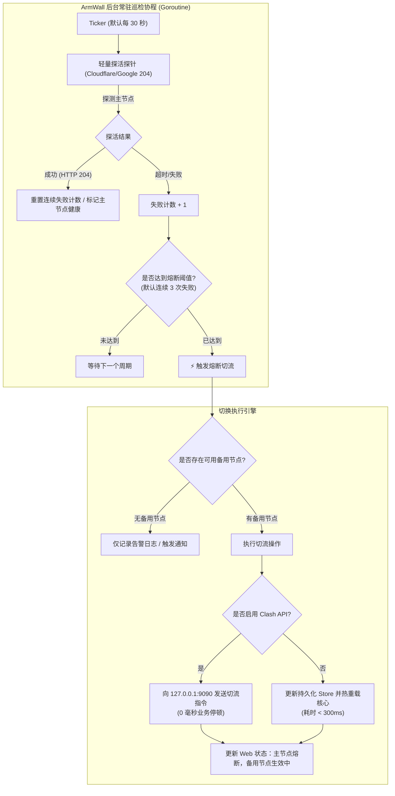
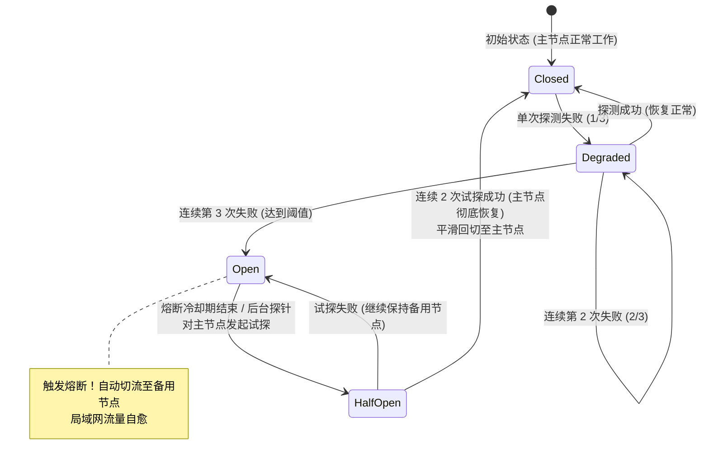

# ArmWall 下版本特性评估提案：后台自动故障转移与熔断机制 (Failover & Circuit Breaker)

> **提案编号**：PROP-20261029-FAILOVER  
> **状态**：📋 待评审 / 计划纳入下一版本（v0.5.0）  
> **关联事故**：[`docs/INCIDENT-REPORT-2026-10-29.md`](INCIDENT-REPORT-2026-10-29.md)  
> **跟踪编号**：`ISSUE-29`（已同步至 [`docs/CONSOLIDATED-IMPROVEMENT-PLAN-2026-10-29.md`](CONSOLIDATED-IMPROVEMENT-PLAN-2026-10-29.md)）  
> **提出时间**：2026-10-29  

---

## 目录

- [一、背景与痛点](#一背景与痛点)
- [二、目标与核心价值](#二目标与核心价值)
- [三、架构与状态机设计](#三架构与状态机设计)
- [四、配置与数据结构变更](#四配置与数据结构变更)
- [五、后台探活协程实现细节](#五后台探活协程实现细节)
- [六、切换动作与低延迟无感切流](#六切换动作与低延迟无感切流)
- [七、资源开销与低功耗控制](#七资源开销与低功耗控制)
- [八、实施阶段与验收准则](#八实施阶段与验收准则)

---

## 一、背景与痛点

在 2026-10-29 的生产故障中，主选节点（`dmit udp naive`）因运营商 UDP QoS / 阻断突发断流，导致局域网全网境外 DNS 解析与外网访问中断达 8 分钟，最终依赖管理员手动登录 Web 控制台进行节点切换才得以恢复。

### 现状痛点
1. **单点故障（SPOF）无自动容灾**：当前 ArmWall 采用“单节点选定直连”或“被动策略组读取”，没有常驻的后台监控巡检；
2. **DNS 黑洞引发客户端雪崩**：主节点一旦假死，境外 DNS 查询报文（`8.8.8.8:53`）持续跌入黑洞，局域网终端重发率激增 18 倍；
3. **运维响应滞后**：故障恢复强依赖人工介入，在无人值守或夜间时段容易导致长时间网络瘫痪。

---

## 二、目标与核心价值

在下一个版本中评估并引入**后台自动故障转移（Failover）与熔断机制**，实现：
1. **自动感知假死**：独立后台 Goroutine 周期性对当前生效的主选节点进行端到端链路探活；
2. **快速熔断切换**：当主节点连续超时达到阈值时，自动触发熔断，秒级切流至预先设置的备用节点；
3. **健康回切（可选）**：主节点链路确认恢复稳定后，支持平滑回切至主选节点；
4. **管理端友好**：在 Web 控制台提供直观的“启用故障转移”、“备用节点选择”、“探活间隔与超时阈值”配置项及熔断状态标识。

---

## 三、架构与状态机设计

### 3.1 核心架构流程



### 3.2 熔断器状态机 (Circuit Breaker State Machine)



---

## 四、配置与数据结构变更

在 `Store` 结构体（[`storage.go`](../storage.go)）与 SQLite `settings` 表中增加故障转移配置块：

```go
type FailoverSettings struct {
    Enabled           bool     `json:"enabled"`             // 是否开启故障转移
    BackupNodeID      string   `json:"backup_node_id"`      // 主选挂掉后的备用节点 ID
    CheckIntervalSec  int      `json:"check_interval_sec"`  // 探活周期（秒，默认 30）
    FailureThreshold  int      `json:"failure_threshold"`   // 连续失败次数触发熔断（默认 3）
    RecoveryThreshold int      `json:"recovery_threshold"`  // 连续成功次数触发回切（默认 2）
    AutoFailback      bool     `json:"auto_failback"`       // 主节点恢复后是否自动切回
    TestURL           string   `json:"test_url"`            // 探针 URL（默认 http://cp.cloudflare.com/generate_204）
}
```

---

## 五、后台探活协程实现细节

1. **生命周期绑定**：
   * 在 `main()` 中随 HTTP 服务启动时派生：`go runFailoverWatchdog(ctx)`；
   * 监听 `ctx.Done()`（响应 SIGTERM/SIGINT），服务优雅退出时安全释放，杜绝资源泄漏。
2. **轻量级连接池**：
   * 采用专用的 `http.Transport`，配置短超时（`DialTimeout: 4s`, `ResponseHeaderTimeout: 5s`）；
   * 探针针对**当前实际出口 SOCKS 端口**或直接绑定目标出站发送，避免经过额外无用层级。
3. **防抖与抗偶发抖动设计**：
   * 必须严格满足 `连续失败次数 >= FailureThreshold`，杜绝公网偶发单次抖动造成频繁震荡切换（Flapping）。

---

## 六、切换动作与低延迟无感切流

系统提供双通道切流路径，确保局域网终端体验最佳：

| 方案 | 触发条件 | 执行方式 | 业务中断时间 |
| :--- | :--- | :--- | :---: |
| **快速通道（首选）** | 节点处于策略组或启用了 Clash API 控制 | 直接调用本地 `http://127.0.0.1:9090/proxies/{group}` PUT 目标节点 | **0 毫秒**（长连接平滑切换） |
| **标准通道（兜底）** | 普通单节点直连模式 | 调用 `setStoreSelectedNode()` 更新活跃配置并执行轻量重载 | **< 300 毫秒** |

---

## 七、资源开销与低功耗控制

针对章鱼星球 S912、玩客云等嵌入式设备进行针对性轻量化：
* **CPU 占用**：Goroutine 绝大部分时间处于 `time.Sleep` / `select` 休眠状态；单次探活仅耗费 1~3ms CPU 时间，全天平均 CPU 负载增量 **< 0.03%**；
* **网络流量**：使用 204 探针，响应体为 0 字节，全天 24 小时探测产生的上行/下行流量总和 **< 1.5 MB**；
* **内存占用**：复用 Go 运行时内部调度，额外内存开销仅约 **十几 KB**。

---

## 八、实施阶段与验收准则

### 阶段 1：核心检测与熔断逻辑开发（Go 后端）
- [ ] 在 `Store` 与 SQLite 中支持 `FailoverSettings` 持久化；
- [ ] 实现 `runFailoverWatchdog` 后台协程与状态机；
- [ ] 编写高覆盖单元测试：模拟主节点超时断开、触发熔断切流、主节点恢复与自动回切。

### 阶段 2：Web 管理后台交互呈现（前端）
- [ ] 在「节点管理 / 策略设置」区域新增「故障转移与高可用」配置卡片；
- [ ] 支持下拉选择备用节点，配置检测间隔与熔断阈值；
- [ ] 页面顶部或节点状态栏增加实时熔断告警角标（如 `[主节点熔断: 已切换至备用节点]`）。

### 阶段 3：真实网络模拟与真机验收
- [ ] 在 `192.168.10.217` 真机上模拟主节点上游网络阻断（iptables 模拟黑洞）；
- [ ] 验证在 90 秒内（3 次 30 秒探测失败）系统自动完成切流，局域网终端无需刷新网络自愈；
- [ ] 验证解除模拟阻断后，系统按设定平滑回切。
