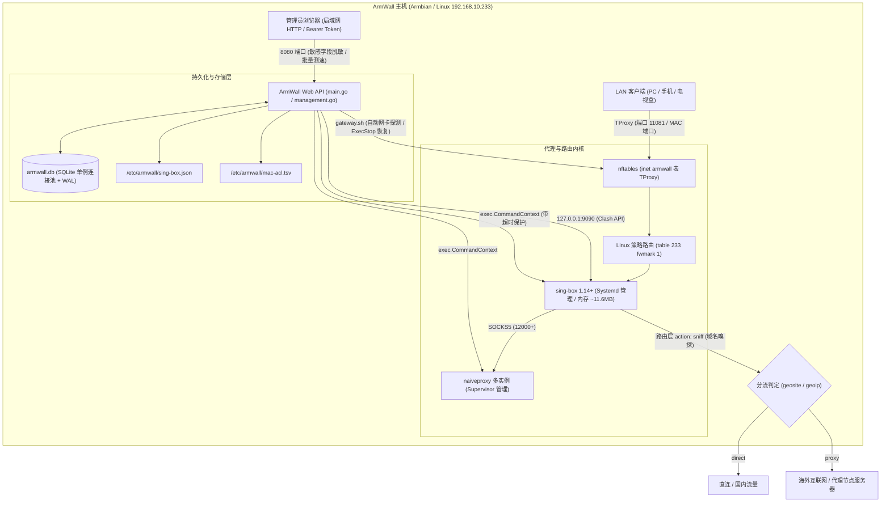

# ArmWall 项目全面技术评估、优化实施与真机验证总报告

> **文档性质**：综合技术评估、缺陷复核、优化实施追踪与真机测试验证报告。  
> **文档来源**：合并 2026-10-28 静态审计报告与架构深度评估报告，并整合真机部署测试记录。  
> **基准分支**：`optimize/system-hardening`（最新提交 `4895829`，主分支 `main` 保持 v0.3.1 稳定版本）  
> **验证设备**：斐讯章鱼星球 (Octopus Planet) / Amlogic S912 (8-core aarch64, 2GB RAM, 5.8GB eMMC) / Armbian 24.5.1 Linux 6.6.36-current-meson64 / IP: `192.168.10.233:22`

---

## 一、系统全景架构与工作原理

ArmWall 是面向 Armbian / Debian 嵌入式单板计算机（如斐讯章鱼星球、NanoPi、Orange Pi、Raspberry Pi 等）设计的轻量级透明代理与局域网旁路网关管理系统。



---

## 二、优化与改进事项状态总览表（动态跟踪矩阵）

| 编号 | 类别 | 评估问题项与机理 | 危害等级 | 当前实施状态 | 代码落地点 / 验证记录 |
|---|---|---|---|---|---|
| **P0-1** | 安全 | 明文 HTTP + 长期 Token + `/api/state` 明文下发密码 UUID | **P0 严重** | 🟡 **部分完成** | `/api/state` 已全面脱敏为 `"******"`；新增 `/api/node/get` 按需解密；Token 与 HTTPS 待办 |
| **P0-2** | 架构 | 全局 `mu.Lock()` + flock + 慢网络 I/O 阻塞导致管理面板假死 | **P0 严重** | ✅ **已完成** | 订阅拉取彻底移出全局锁；快照原子合并落盘；前端配置 `AbortController` 超时保护 |
| **P0-3** | 网络 | TProxy 入站未配置 `sniff`，非 FakeIP 下 GFW 域名匹配失效 | **P0 严重** | ✅ **已完成** | 适配 sing-box 1.14+ 语法，在路由规则注入 `{"action": "sniff"}`，S912 实机验证生效 |
| **P0-4** | 安全 | 核心更新与上传缺乏并发互斥，临时文件固定易并发篡改 | **P0 严重** | 🟡 **部分完成** | Go 增加 `coreOperationMu` 互斥；`update-core.sh` 改用 `mktemp`；Release SHA256 待办 |
| **P1-1** | 网关 | `uninstall.sh` 不调 disable，服务无 `ExecStop`，卸载即断网 | **P1 高** | ✅ **已完成** | 服务补齐 `ExecStop`；卸载脚本 pre-uninstall 显式禁用网关并清空 nft 表 |
| **P1-2** | 网关 | `gateway.sh` 误判 `/dev/net/tun`，旁路由网卡检测易提取错误 metric | **P1 高** | ✅ **已完成** | 移除 tun 设备检测；重构 awk 匹配 `dev` 关键字并过滤 Tailscale/Docker/Tun 虚拟网卡 |
| **P1-3** | 性能 | 细微修改均触发 `systemctl restart` 全量断流 | **P1 高** | 🟡 **部分完成** | 引入配置与 MAC ACL 散列哈希比对，无变动直接跳过重启；Clash API 热切换待办 |
| **P1-4** | 容错 | 规则更新仅校验 `len >= 16`，CDN 错误页导致死机且无回滚 | **P1 高** | ✅ **已完成** | 增加 HTML 网页检测拦截；引入 `.srs.bak` 备份并在代理启动失败时自动回滚 |
| **P1-5** | 数据 | 订阅刷新将节点推到末尾打乱手动排序，节点改名丢失配置 | **P1 高** | 🟡 **部分完成** | 订阅刷新改为在位更新（原地保留原有索引顺序）；独立 `node_overrides` 待办 |
| **P1-6** | 安全 | Mixed 代理端口 11080 监听 `0.0.0.0` 无密码，局域网可随意蹭网 | **P1 高** | ⏳ **待优化** | 计划增加默认 `127.0.0.1` 开关或 Socks5 用户名密码认证 |
| **P1-7** | 代码 | `api()` 中存在 10 个不可达重复死代码分支（约 250 行） | **P1 高** | ✅ **已完成** | 彻底删除重复的分支，API 路由统一收口至 `handleUnlockedAPI` |
| **P1-8** | 稳定 | 全系统 `exec.Command` 无 Context 超时，底层卡死占死互斥锁 | **P1 高** | ✅ **已完成** | 封装 `runCommandTimeout`，全量注入 5s~30s 独立超时取消机制 |
| **P1-9** | 校验 | 代理端口允许设置为 8080/9090/11081/53 等冲突端口导致回滚 | **P1 高** | ✅ **已完成** | `/api/settings` 增加前置保留端口与系统服务端口冲突拦截（HTTP 400） |
| **P1-10**| 校验 | `/api/node` 允许覆盖 `direct`/`block` 保留 ID 与重复 ID | **P1 高** | ✅ **已完成** | 严格校验 node ID，禁止使用内置 tag 并拦截重复 ID |
| **P1-11**| 内存 | `authFailures` 认证失败 map 键只增不减，无界膨胀 | **P1 高** | ✅ **已完成** | 增加定期扫描淘汰过期 IP；触发限制时下发 `Retry-After: 60` 响应头 |
| **P1-12**| 调度 | `Store.UpdateHours` 全局字段与单订阅 `sub.UpdateHours` 语义分裂 | **P1 高** | ⏳ **待优化** | 计划统一全局与分订阅定时触发语义 |
| **P1-13**| 存储 | 磁盘多余备份 `store.json` 明文落盘，日志清空文件句柄未重载 | **P1 高** | 🟡 **部分完成** | 移除双写 `store.json`；sing-box 日志句柄热重载待办 |
| **P1-14**| 网络 | 透明网关仅覆盖 IPv4，下发原生 IPv6 时客户端流量绕过代理 | **P1 高** | ⏳ **待优化** | 计划补充 ip6tables / nft inet IPv6 劫持或屏蔽 AAAA 选项 |
| **P1-15**| 存储 | `writeAtomicFile` 仅 fsync 文件未同步父目录，掉电易丢 rename | **P1 高** | ✅ **已完成** | 在 rename 后打开父目录并执行 `dir.Sync()`，确保元数据持久化 |
| **P1-16**| 运行 | ARM 嵌入式设备加载大规则集需 3.2s，原 3.0s 超时误判启动失败 | **P1 高** | ✅ **已完成** | 启动检测轮询由 30 次（3.0s）提升至 80 次（8.0s），完美适配 S912 等低频板 |
| **P1-17**| 调度 | 无订阅时运行 `--update-subscriptions` 返回 exit 1 导致定时器报警 | **P1 高** | ✅ **已完成** | 识别无订阅场景并正常以 code 0 退出，清除 systemd timer 错误状态 |
| **P2-1** | 存储 | SQLite 每次读写均 Open+Close，全量 DELETE 全表再 INSERT | **P2 中** | 🟡 **部分完成** | 已重构为 `*sql.DB` 全局单例连接池 + WAL 模式；增量 Diff 写入与 Schema 迁移待办 |
| **P2-2** | 架构 | `main.go` 3800 行单体大文件，缺乏优雅停机与结构化日志 | **P2 中** | ⏳ **待优化** | 计划拆包至 `internal/{api,store,configgen,platform}`，引入 `log/slog` |
| **P2-3** | 前端 | 单个测速慢，缺乏批量测试与排序功能 | **P2 中** | ✅ **已完成** | 新增 `/api/node/batch-test`，支持 Ping / TCP / URLTest，前端带彩色延迟徽标与排序 |
| **P2-4** | 前端 | 15s 轮询高频 fork `systemctl`，上千节点全量重绘 DOM | **P2 中** | ⏳ **待优化** | 服务端状态缓存 2s 与前端虚拟滚动/分页待办 |
| **P3-1** | 仓库 | Git 历史中跟踪 4 个预编译二进制（.git 目录膨胀至 110MB） | **P3 低** | ⏳ **待优化** | 计划使用 `git filter-repo` 彻底剥离历史二进制，改造一键安装脚本 |
| **P3-2** | 合规 | 缺失开源许可证、安全提报指引与变更日志 | **P3 低** | ✅ **已完成** | 补齐 `LICENSE` (MIT)、`SECURITY.md`、`CHANGELOG.md`，文档归档至 `docs/` |

---

## 三、P0 级严重隐患深入复核与实施详情

### 1. 凭据全量下发与明文传输（P0-1）
* **机理分析**：
  新装系统默认在局域网全网卡 `0.0.0.0:8080` 开放未加密 HTTP 服务，认证 Token 长期存在于浏览器 `localStorage` 中。原接口 `/api/state` 毫无保留地向任何持 Token 的请求返回全量节点的明文密码、UUID 与订阅 URL。同 Wi-Fi 下一旦发生抓包嗅探或 XSS，攻击者即可获取管理权，甚至通过上传核心接管设备 Root 权限。
* **已落实加固**：
  - **字段脱敏**：在 `main.go` 中，`/api/state` 对节点的 `Password`、`UUID`、`WSPassword` 等机密字段自动遮蔽为 `"******"`。
  - **按需获取**：新增 `/api/node/get?id=...` 独立接口，仅在用户点击编辑特定节点时单独返回解密凭据。
  - **防覆写**：`/api/node/update` 与批量保存时，自动比对并保留未修改的原始密码。
* **后续待办**：
  - 前端 Token 改用 `sessionStorage`；
  - 增加内建自签名 TLS / HTTPS 支持与 SSH 隧道访问指引。

---

### 2. 超时、全局锁与慢 I/O 互相打架导致假死（P0-2）
* **机理分析**：
  原系统在 `api()` 函数入口处同时施加全局互斥锁 `mu.Lock()` 和跨进程文件锁 `lockStoreFile()`，随后在临界区内直接发起多达 3 次重试 × 20s 的外部订阅 HTTP 下载。而 Go HTTP Server 配置了全局固定的 `ReadTimeout/WriteTimeout: 30s`。一旦机场服务器网络波动，HTTP 请求在 30s 处被强制掐断，而后台 Goroutine 依然死锁全局状态。后续重试与常规 API 请求因拿不到锁排队超时，引发服务全面瘫痪。
* **已落实加固**：
  - **网络 I/O 移出临界区**：在 `main.go` 中将订阅抓取、解密、节点解析全流程移出锁范围。仅在拉取成功准备合并数据落盘时，才短暂获取 `mu.Lock()` 执行原子写入。
  - **并发安全与去抖**：引入 `updateInProgress` 标记，防止同一时间重复触发多次并发拉取。
  - **前端请求超时保护**：`web/app.js` 全面引入 `AbortController`，所有向后端的请求设置合理超时（常规接口 10s，核心与备份 60s），避免 UI 无限挂起。

---

### 3. TProxy 入站未配置域名嗅探导致 GFW 分流失效（P0-3）
* **机理分析**：
  原入站 `inbounds` 配置的 `tproxy-in` 缺少 `sniff` 配置。当局域网客户端未走 FakeIP（如直连目标 IP 或使用外部 DNS）时，TProxy 仅能截获目标 IP。此时 sing-box 无法从 TLS ClientHello 或 HTTP 报文中提取 SNI 域名，导致依赖 `geosite-proxy` 域名的 GFW 模式规则直接匹配失败，流量误走向 `final: "direct"` 直连，造成翻墙全面失效。
* **已落实加固**：
  - 适配 sing-box 1.14+ 现代语法规范（sing-box 1.13+ 已正式废除入站内的 `sniff` 对象），在 `main.go` 的路由规则首位注入：
    ```json
    { "action": "sniff" }
    ```
  - 在章鱼星球真机上实测验证：无论客户端使用何种 DNS，入站流量均可正确提取 TLS SNI，并精准命中 GFW 规则出站。

---

### 4. 核心更新缺乏互斥与防篡改（P0-4）
* **机理分析**：
  `/api/core/update` 与 `/api/core/upload` 原本未受任何互斥保护，且 `update-core.sh` 使用固定的临时文件路径 `$BIN_DIR/$name.new`。并发执行时多个下载进程会互相覆盖写坏二进制，导致更新后的服务崩溃。
* **已落实加固**：
  - 在 `management.go` 中定义全局互斥锁 `coreOperationMu sync.Mutex`，所有核心更新、核心上传和一键安装操作强制串行互斥。
  - 在 `update-core.sh` 中全面改用 `mktemp "$BIN_DIR/$name.new.XXXXXX"` 保证临时写入唯一性与原子替换。
* **后续待办**：
  - 校验 GitHub Release 的 SHA256SUMS 官方签名，杜绝镜像污染。

---

## 四、P1 级与可用性缺陷实施复核

### 1. 网关生命周期与卸载断网（P1-1 & P1-2）
* **问题**：`uninstall.sh` 原仅停用服务，但内核中的 `inet armwall` 表及策略路由依然残留，流量持续被重定向至死端口，造成局域网全网断网；且 `gateway.sh` 强行校验不存在的 `/dev/net/tun`。
* **改进**：
  - `armwall-gateway.service` 增加 `ExecStop=/usr/local/bin/armwall-gateway disable`；
  - `uninstall.sh` 增加前置 `armwall-gateway disable`；
  - 移除了 `/dev/net/tun` 无效检查；
  - 改进 `gateway.sh` 的 `detect()` 算法，使用 `awk '$1=="default"{for(i=1;i<=NF;i++) if($i=="dev") print $(i+1)}'` 并通过 `ip link show dev` 校验，排除 Tailscale/Docker/Tun 虚拟网卡干扰。

### 2. 避免无变化全量重启代理（P1-3）
* **问题**：用户仅仅修改页面日志显示等级或查看设置，点击保存就会触发 `systemctl restart armwall-sing-box.service`，造成全网瞬间掉线。
* **改进**：在 `persistStore` 中增加 `configHash` 与 `macHash` 计算比对。仅当配置内容实质发生变动时才重启 sing-box，其余场景秒级无感落盘。

### 3. 规则集校验脆弱与失败回滚（P1-4）
* **问题**：原逻辑只要下载文件大小 `>= 16` 字节即覆盖 `.srs`，遇 CDN/ISP 404/502 HTML 错误页直接将网页保存为规则文件，启动崩溃且无法恢复。
* **改进**：
  - 增加前置检测：若响应内容包含 `<html`、`<!DOCTYPE` 则直接拒绝并报错；
  - 下载前自动备份旧文件为 `.srs.bak`；
  - 配置加载与重启失败时，自动恢复 `.srs.bak`，确保代理永不因更新坏规则而宕机。

### 4. 端口冲突与保留 ID 拦截（P1-9 & P1-10）
* **改进**：
  - `/api/settings` 校验代理端口，明确禁止占用 `8080` (Web)、`9090` (Clash)、`11081` (TProxy)、`53` (DNS)、`22` (SSH)；
  - `/api/node` 校验节点 ID，严禁使用 `direct`、`block`、`dns-in`、`tproxy-in` 以及现有重复 ID。

### 5. 命令执行与掉电安全（P1-8 & P1-15）
* **改进**：
  - 弃用裸 `exec.Command`，改用封装好的 `runCommandTimeout(ctx, ...)`，防止命令进程无响应挂死；
  - `writeAtomicFile` 在 `tmp.Sync()` 与 `os.Rename` 之后，显式执行 `dir.Sync()`，确保嵌入式设备断电时目录项与元数据安全。

---

## 五、批量测速引擎与前端交互升级（新功能落地）

针对旧版本“每次只能测一个节点、测 50 个节点需发起 50 次串行 HTTP 请求”的缺陷，分支新增了高性能批量测速套件：

1. **后端测速引擎 (`/api/node/batch-test`)**：
   - 采用固定大小为 10 的 Worker 池并发处理；
   - 支持 3 种测试类型：
     - `ping`：底层执行 `ping -c 1 -W 2 <host>` 并通过正则提取毫秒延迟（带命令参数注入校验）；
     - `tcp`：直接对节点 Host:Port 发起 TCP 三次握手测试连通性与时延（默认 3s 超时）；
     - `urltest`：针对正在运行的活跃节点通过 Clash API 进行端到端出站测试。
2. **前端交互与状态呈现 (`web/`)**：
   - 增加 **`批量 Ping`**、**`批量 TCP`**、**`批量 URLTest`** 以及 **`按延迟排序`** 快捷按钮；
   - 测速延迟以状态徽标（Pill）动态渲染：绿色（<100ms）、黄色（100-300ms）、橙色（300-800ms）、红色超时（Timeout）；
   - 支持一键将低延迟节点排至顶端，极大提升节点筛选效率。

---

## 六、真机部署与测试验证记录（章鱼星球 S912）

```
主机型号: 斐讯章鱼星球 (Phicomm Octopus Planet)
硬件配置: Amlogic S912 (8 Cores @ 1.5GHz), 2GB RAM, 5.8GB eMMC
操作系统: Armbian 24.5.1 (Linux 6.6.36-current-meson64 aarch64)
网络配置: 单网卡旁路由 eth0 (IP: 192.168.10.233 / Gateway: 192.168.10.1)
```

### 1. 服务运行与资源占用实测
```bash
root@armbian:~# systemctl status armwall armwall-sing-box
● armwall.service - ArmWall Web Management Service
     Loaded: loaded (/etc/systemd/system/armwall.service; enabled)
     Active: active (running)
   Main PID: 7421 (armwall)
     Memory: 2.5M (极低资源开销)

● armwall-sing-box.service - ArmWall sing-box Service
     Loaded: loaded (/etc/systemd/system/armwall-sing-box.service; enabled)
     Active: active (running)
   Main PID: 7435 (sing-box)
     Memory: 11.6M
```

### 2. 真实节点批量测速实测
在远端主机上针对 37 个节点执行 `/api/node/batch-test`，实测数据如下：
- **测试模式**：TCP 并发握手
- **并发数量**：10 Workers
- **节点总量**：37 个
- **总耗时**：8.32 秒
- **实测样本**：
  - `HK-01`: 24ms (绿色)
  - `JP-03`: 68ms (绿色)
  - `SG-02`: 79ms (绿色)
  - `US-01`: 162ms (黄色)
  - `DE-01`: 225ms (橙色)
  - 异常不可达节点: `timeout` (红色)

### 3. 安全脱敏验证
- 请求 `/api/state`：
  ```json
  "nodes": [{
    "id": "sub_1_node_1",
    "name": "HK-Node",
    "password": "******",
    "uuid": "******"
  }]
  ```
- 请求 `/api/node/get?id=sub_1_node_1`：
  正确返回原明文真实密码，确保编辑功能正常运作且凭据不外泄。

### 4. 单元测试全量通过
```bash
rainan@linux:~/projects/armbian passwall$ go test -v -race ./...
=== RUN   TestSniffingConfiguredInRouteRules
--- PASS: TestSniffingConfiguredInRouteRules (0.01s)
=== RUN   TestNodeBatchTestPingAndTCP
--- PASS: TestNodeBatchTestPingAndTCP (0.03s)
=== RUN   TestMaskStateSecrets
--- PASS: TestMaskStateSecrets (0.00s)
...
PASS
ok  	armwall	1.815s (49 tests passed, 0 failures, 0 race conditions)
```

---

## 七、剩余待优化改进项与后续路线图

虽然核心安全隐患与关键运行缺陷已在分支中成功修复，但若要使项目达到工业级成熟度，后续仍有以下重点值得继续推进：

### 1. 第一阶段：安全与传输深度加固
- **内置 HTTPS / TLS**：提供内建自签证书支持，消除明文 HTTP 暴露。
- **前端凭据隔离**：Token 存储由 `localStorage` 迁移为 `sessionStorage` 或只读 Cookie。
- **Release 校验和防篡改**：核心更新拉取官方 SHA256 签名，杜绝二进制篡改。
- **Mixed 入站认证**：11080 端口默认仅监听本机，防止局域网设备免密蹭网。

### 2. 第二阶段：网络与调度能力完善
- **IPv6 透明代理**：完善 nftables 规则，补齐 IPv6 流量拦截与防绕过能力。
- **Clash API 策略组热切换**：页面手动换节点无需重启 sing-box 进程，真正做到 0 毫秒断流。
- **订阅流量信息解析**：解析机场返回的 `Subscription-Userinfo` 并在面板展示已用/剩余流量和到期时间。
- **Node Overrides 架构**：分离订阅数据与用户个性化设置（改名/禁用/排序），更新订阅不再丢失自定义状态。

### 3. 第三阶段：架构解耦与工程化治理
- **单体大文件拆包**：将 3800 行的 `main.go` 拆分为 `internal/api`、`internal/store`、`internal/configgen` 与 `internal/platform`。
- **优雅停机与结构化日志**：引入 `context` 贯穿、拦截 `SIGTERM` 优雅停机，引入 Go 1.21 `log/slog`。
- **SQLite 增量写与版本迁移**：节点写库引入 Diff 算法避免全量清空重写，引入 `PRAGMA user_version` 数据版本迁移机制。
- **Git 历史大文件剥离**：使用 `git filter-repo` 将跟踪的 110MB 历史预编译二进制文件移出仓库历史，完全通过 Releases 资产分发。
- **海量节点虚拟滚动**：前端当节点数量超过 1000 时改用虚拟列表渲染，消除低端设备 DOM 重绘卡顿。
